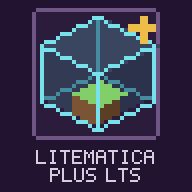

<p align="center"></p>

# Litematica Plus LTS

[](README.md)
[](README.md)
[](README.md)
[](README.md)
[](LICENSE)

Schematic holograms, area selection, verification, material lists, easy place and paste. A from-scratch, standalone replacement for Litematica that reads and writes `.litematic` files.

**Руководство пользователя с быстрым стартом:** [docs/USER_GUIDE_RU.md](docs/USER_GUIDE_RU.md) · **User guide with a quick start:** [docs/USER_GUIDE_EN.md](docs/USER_GUIDE_EN.md)

## Русский

### Что это

`Litematica Plus LTS` (mod id `litematicaplus`) — клиентский Fabric-мод для Minecraft 26.3, написанный с нуля вместо Litematica. Ему не нужны ни Litematica, ни MaLiLib: он сам читает и сохраняет `.litematic`, показывает схему полупрозрачной голограммой, сравнивает её с миром и помогает строить. Папка `schematics/` общая с Litematica, поэтому существующая библиотека схем открывается без переноса.

### Возможности

Подробное описание каждой функции: [справочник возможностей](docs/USER_GUIDE_RU.md#справочник-возможностей).

| Раздел | Что есть |
|---|---|
| Файлы | Чтение и запись `.litematic`, импорт `.nbt`, Sponge `.schem` v2/v3, MCEdit/Schematica `.schematic`, блюпринты Axiom `.bp`; 3D-превью схем |
| Размещения | Сколько угодно схем в мире, перемещение, поворот на 90°, отражение, блокировка, подрегионы, редактор размещения, запись места в файл |
| Голограмма | Блоки-призраки с настраиваемой прозрачностью, жидкости, слои и границы X/Z |
| Проверка | Сравнение с миром в реальном времени, подсветка «нет блока», «не тот блок», «не то состояние», «лишний», умное сравнение свойств |
| Материалы | Всего, осталось, есть в инвентаре (включая шалкеры), поиск, экспорт в Excel, CSV и Markdown, замены блоков, помощник в контейнерах |
| Лёгкая установка | Возможности EasyPlaceFix внутри мода: установка по призраку и удержанием, пипетка, защита слотов, защита от лишних блоков, сущности схемы |
| Выделение и вставка | Области из нескольких боксов, сохранение в `.litematic`; в творческом режиме вставка, заливка, замена и удаление |
| Командная стройка | Зоны по X, Z и этажам с процентом готовности |
| Интеграции | Syncmatica, Jade, VoxyMap, Axiom (все необязательны) |
| Интерфейс | Вкладка «Клавиши» с подсветкой конфликтов, перетаскиваемая инфопанель, подсветка блоков, которые можно поставить |
| Производительность | Схема на 4,4 млн блоков загружается из файла за ~0,1 с и проверяется в фоновых потоках за ~1,7 с |

Что пока не перенесено из Litematica:

- вставка сущностей на сервере (командами; в выживании рамки, картины и стойки ставятся лёгкой установкой), проекты схем;
- на сервере вставка не переносит содержимое контейнеров (ограничение длины команды);
- с шейдерами Iris призраки рисуются поверх готового кадра, поэтому на них не действуют тени, блум и тональная коррекция пакета; сундуки и другие блоки со специальной моделью рисуются игрой как обычные, непрозрачными;
- в виде сверху рельеф виден только в прогруженных вокруг игрока чанках; с шейдерами туман пакета отодвигается через значение `far` от Iris, и в отдельных пакетах рельеф всё равно может тонуть в дымке;
- материалы для сущностей в список не входят.

Результаты проверки совместимости: [раздел в руководстве](docs/USER_GUIDE_RU.md#совместимость).

### Управление

Клавиши назначаются в меню мода (Настройки → Клавиши) или в Настройки → Управление → Litematica Plus.

| Действие | Клавиша по умолчанию |
|---|---|
| Открыть меню | `H` |
| Вкладка «Слои» и границы X/Z | `F7` |
| Включить/выключить границы X/Z | не назначена |
| Редактор размещения в мире | не назначена |
| Показать/скрыть схемы, лёгкая установка, инструмент | не назначены |
| Следующий режим инструмента, режим слоёв, слой выше/ниже | не назначены |
| Установка удержанием, защита при раскопках, автосмена инструмента, ломать неверные блоки, замена материалов | не назначены |
| Взять материалы из открытого контейнера | не назначена |
| Открыть список материалов | не назначена |
| Подсветка того, что можно поставить | не назначена |

В редакторе размещения:

| Действие | Ввод |
|---|---|
| Двигать схему по земле | перетаскивание левой кнопкой |
| Ввести координату | клик по полю X/Y/Z, число, `Enter` |
| Вставить «x y z» из буфера | `Ctrl+V` |
| Сдвиг на шаг (с `Shift` — на 10 шагов) | стрелки, `PgUp`/`PgDn`, кнопки панели |
| Высота / масштаб в виде сверху | колесо |
| Поворот / отражение / вид сверху | `R` / `M` / `T` |
| Двигать вид сверху | перетаскивание правой кнопкой |

С инструментом в руке (по умолчанию палка):

| Действие | Ввод |
|---|---|
| Сменить режим (Область → Перемещение → Вставка → Удаление) | `Ctrl` + колесо или средняя кнопка |
| Область: угол 1 / угол 2 | левая / правая кнопка |
| Перемещение: перенести размещение / повернуть на 90° | левая / правая кнопка |
| Вставка / Удаление: начать (два клика: запрос и подтверждение) / отменить | левая / правая кнопка |
| Сдвинуть бокс или размещение на 1 блок по взгляду | `Alt` + колесо |
| Взять свою позицию вместо блока под прицелом | `Alt` + клик |

Без инструмента: правая кнопка по призраку или маркеру сущности — лёгкая установка (если включена), средняя кнопка — пипетка.

### Настройки

Меню (`H`) или **Mod Menu**: вкладки «Быстрый доступ», «Схемы», «Размещения», «Слои», «Новая схема», «Материалы», «Замены», «Проверка», «Настройки».

| Файл | Что хранит |
|---|---|
| `config/litematicaplus.json` | Настройки |
| `config/litematica-plus-session.json` | Размещения и выделения |
| `config/litematica-plus-substitutes.json` | Список замен материалов |

Файлы пишутся атомарно, с резервной копией `.bak`.

### Установка

1. **Fabric Loader** `0.19.3+` и **Fabric API** `0.161.0+26.3`.
2. Отключите Litematica, MaLiLib и EasyPlaceFix, если они стоят: их функции уже внутри мода. Мод ставится вместо Litematica, а не вместе с ней: если обе лежат в `mods/`, при запуске поверх главного меню появится предупреждение.
3. Скопируйте `litematica-plus-lts-1.0.7.jar` из `build/libs/` в папку `mods/`.
4. **Mod Menu** — опционально, открывает меню мода из списка модов.

**Требования:** Minecraft `26.3` · Java `25` · только клиент.

### Сборка

```powershell
.\gradlew.bat clean build
```

Готовый JAR: `build/libs/litematica-plus-lts-1.0.7.jar`.

Рядом собирается отдельная версия с принтером: `build/libs/litematica-plus-lts-1.0.7-printer.jar` (задача `printerJar`). В `mods/` кладётся только один из двух файлов. Многие серверы запрещают принтеры, в обычной версии его кода нет. Подробности: [версия с принтером](docs/USER_GUIDE_RU.md#версия-с-принтером).

Команды проверки на своих схемах и игровых тестов: [раздел в руководстве](docs/USER_GUIDE_RU.md#проверка-и-автотесты).

---

## English

### What It Is

`Litematica Plus LTS` (mod id `litematicaplus`) is a client-side Fabric mod for Minecraft 26.3, written from scratch as a replacement for Litematica. It needs neither Litematica nor MaLiLib: it reads and writes `.litematic` itself, shows a schematic as a translucent hologram, compares it with the world, and helps you build. It shares the `schematics/` folder with Litematica, so an existing library opens without any migration.

### Features

A detailed description of every feature: [feature reference](docs/USER_GUIDE_EN.md#feature-reference).

| Area | What is there |
|---|---|
| Files | Reads and writes `.litematic`, imports `.nbt`, Sponge `.schem` v2/v3, MCEdit/Schematica `.schematic` and Axiom `.bp` blueprints; 3D schematic previews |
| Placements | Any number of schematics per world, move, 90° rotation, mirror, lock, sub-regions, a placement editor, the placement stored in the file |
| Hologram | Ghost blocks with adjustable opacity, fluids, layers and X/Z bounds |
| Verification | Live comparison with the world, "missing", "wrong block", "wrong state" and "extra" highlights, smart property comparison |
| Materials | Total, still needed, in inventory (shulker boxes included), search, export to Excel, CSV and Markdown, block replacements, a helper in containers |
| Easy place | The EasyPlaceFix feature set built in: placing on ghosts and by holding the button, pick block, locked slots, no stray blocks, schematic entities |
| Selection and paste | Areas made of several boxes, saving to `.litematic`; paste, fill, replace and delete in creative |
| Team builds | Zones along X, Z and floors with a progress percentage |
| Integrations | Syncmatica, Jade, VoxyMap, Axiom (all optional) |
| Interface | A Hotkeys tab that marks conflicts, a draggable info panel, a highlight for placeable blocks |
| Performance | A 4.4 million block schematic loads from disk in ~0.1 s and is verified on background threads in ~1.7 s |

Not ported from Litematica yet:

- pasting entities on a server (through commands; in survival, frames, paintings and armor stands are placed by easy place), schematic projects;
- server-side paste does not carry container contents (command length limit);
- with Iris shaders the ghosts are drawn on top of the finished frame, so a pack's shadows, bloom and tone mapping do not apply to them; chests and other blocks with a special model are drawn by the game as ordinary, opaque blocks;
- in the view from above, terrain is visible only in the chunks loaded around the player; with shaders the pack's fog is pushed back through the `far` value Iris provides, and some packs may still hide the terrain in haze;
- materials for entities are not part of the material list.

Compatibility test results: [section in the guide](docs/USER_GUIDE_EN.md#compatibility).

### Controls

Keys are bound in the mod's menu (Settings → Hotkeys) or in Options → Controls → Litematica Plus.

| Action | Default key |
|---|---|
| Open the menu | `H` |
| Layers tab and X/Z bounds | `F7` |
| Toggle X/Z bounds | unbound |
| Placement editor in the world | unbound |
| Show or hide schematics, easy place, tool item | unbound |
| Next tool mode, layer mode, layer up/down | unbound |
| Hold to keep placing, excavation guard, auto tool switch, break wrong blocks, substitute materials | unbound |
| Take materials from the open container | unbound |
| Open the material list | unbound |
| Highlight placeable blocks | unbound |

In the placement editor:

| Action | Input |
|---|---|
| Move the schematic along the ground | drag with the left button |
| Type a coordinate | click the X/Y/Z field, type the number, `Enter` |
| Paste "x y z" from the clipboard | `Ctrl+V` |
| Nudge by the step (`Shift`: 10 steps) | arrow keys, `PgUp`/`PgDn`, panel buttons |
| Height / zoom in the view from above | scroll |
| Rotate / mirror / view from above | `R` / `M` / `T` |
| Pan the view from above | drag with the right button |

While holding the tool item (a stick by default):

| Action | Input |
|---|---|
| Switch mode (Area → Move → Paste → Delete) | `Ctrl` + scroll, or middle click |
| Area: corner 1 / corner 2 | left / right click |
| Move: move the placement / rotate it by 90° | left / right click |
| Paste / Delete: start (two clicks: ask, then confirm) / cancel | left / right click |
| Nudge the box or placement one block along your view | `Alt` + scroll |
| Use your own position instead of the targeted block | `Alt` + click |

Without the tool: right-click a ghost or an entity marker for easy place (when enabled), middle-click for pick block.

### Configuration

The menu (`H`) or **Mod Menu**: tabs Quick Access, Schematics, Placements, Layers, New schematic, Materials, Replacements, Verifier, Settings.

| File | Holds |
|---|---|
| `config/litematicaplus.json` | Settings |
| `config/litematica-plus-session.json` | Placements and selections |
| `config/litematica-plus-substitutes.json` | Material substitutes |

The files are written atomically, with a `.bak` backup.

### Installation

1. **Fabric Loader** `0.19.3+` and **Fabric API** `0.161.0+26.3`.
2. Disable Litematica, MaLiLib and EasyPlaceFix if they are installed: their features are already inside the mod. The mod replaces Litematica rather than going alongside it: if both are in `mods/`, a warning appears over the title screen at startup.
3. Copy `litematica-plus-lts-1.0.7.jar` from `build/libs/` into `mods/`.
4. **Mod Menu** — optional, opens the mod's menu from the mod list.

**Requirements:** Minecraft `26.3` · Java `25` · client-only.

### Building

```powershell
.\gradlew.bat clean build
```

Output JAR: `build/libs/litematica-plus-lts-1.0.7.jar`.

A separate printer edition is built next to it: `build/libs/litematica-plus-lts-1.0.7-printer.jar` (task `printerJar`). Put only one of the two files into `mods/`. Many servers forbid printers, and the regular edition has no printer code. Details: [printer edition](docs/USER_GUIDE_EN.md#printer-edition).

Commands for checking your own schematics and for the in-game tests: [section in the guide](docs/USER_GUIDE_EN.md#checks-and-automated-tests).

## Лицензия / License

[MIT](LICENSE). Developed by LTS_Server.

The easy place behaviour (server-side turn, tick pacing, follow-up clicks, note block tuning, sign and crafter data, substitutes, excavation guard, tool switch, entity placement, material export and the container helper) re-implements the feature set of [EasyPlaceFix](https://github.com/223225zzzkkk/easyplaceFix) (MIT) and its LTS_Server fork for this mod's own engine. No Litematica or MaLiLib code is used.
